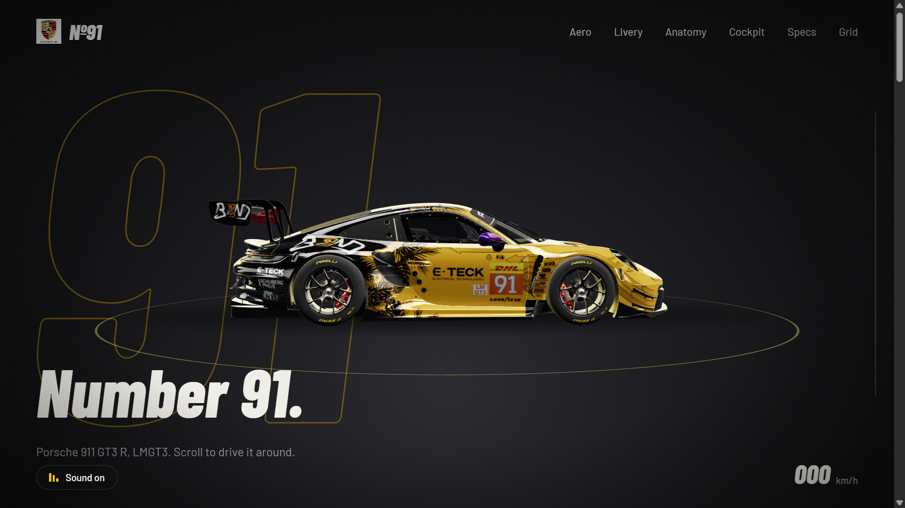

# Porsche 992 GT3 R

A 3D interactive Porsche 992 GT3 R project, showcasing the iconic GT3 racing car with a focus on visual detail and an immersive presentation.

## Features
- Detailed Porsche 992 GT3 R model.
- Immersive 3D presentation.
- Realistic visual experience.
- Interactive elements and sound effects.

## Technologies
- HTML
- CSS
- JavaScript
- Three.js

## Live Demo
[View Project](https://medelbo3.github.io/porsche_992_gt3_r/)

## Source Code
[GitHub Repository](https://github.com/MEDELBOU3/porsche_992_gt3_r)

---

Created by **MEDELBOU3**
